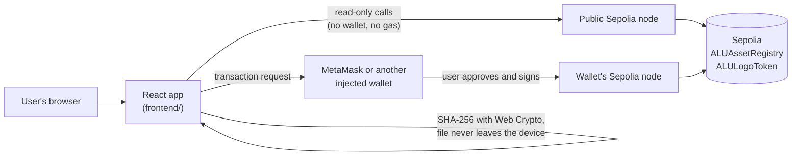

# ALU Logo Registry dApp

A web application that lets anyone at African Leadership University, or outside it, work with the ALU logo contracts on Ethereum from a browser, without writing code or opening a terminal:

* **Verify** whether a logo file is the authentic ALU logo, with no wallet and no fee.
* **Register** a new file by its SHA-256 fingerprint, computed in the browser, and receive an NFT for it.
* **See and distribute** ALUT ownership shares of the logo from a live dashboard.

The smart contracts are the ones already deployed and verified on the Sepolia test network: `ALUAssetRegistry` (ERC-721) stores each file's fingerprint and `ALULogoToken` (ERC-20) splits the logo's ownership into 1,000,000 shares. The frontend is the front door to them: the contracts remain the only backend, and there is no server of our own.

| | Sepolia address |
|---|---|
| ALUAssetRegistry | [0x9f92D707a21A3212aBCd5Fd22E74A6fEBA19e63f](https://sepolia.etherscan.io/address/0x9f92D707a21A3212aBCd5Fd22E74A6fEBA19e63f) |
| ALULogoToken | [0xD5B6E32ac49F4dC38F429773b5AA1C49e50CcA75](https://sepolia.etherscan.io/address/0xD5B6E32ac49F4dC38F429773b5AA1C49e50CcA75) |
| ALU wallet (contract owner) | [0xA105E8D690313a5ffad15f807f108a3d011Eb79D](https://sepolia.etherscan.io/address/0xA105E8D690313a5ffad15f807f108a3d011Eb79D) |

## The registered ALU logo

[alu-logo.png](alu-logo.png) is registered as token **1** of `ALUAssetRegistry`. Its SHA-256 hash is:

```
0xe03128e7ed668d74c334ed965edf89d0e1b3da112f6aeb6233bfd191ad829348
```

Anyone can reproduce it with `sha256sum alu-logo.png` or `npm run hash`. A copy that looks the same but was re-saved, resized or converted to another format has different bytes and therefore a different hash, so the dApp reports it as modified.

## How the frontend connects to the contracts



The app builds two kinds of contract objects with ethers.js v6, from the ABIs and addresses in [frontend/src/contracts/](frontend/src/contracts/):

* **Read-only**, through a `JsonRpcProvider` pointed at a public Sepolia node. These work for every visitor, with or without a wallet, and cost nothing.
* **Signing**, through a `BrowserProvider` wrapped around the wallet the browser injects (`window.ethereum`). Every write goes to the wallet, which shows the transaction and signs it only if the user approves. The app never sees a private key.

| Contract function | Kind | Used on |
|---|---|---|
| `ALUAssetRegistry.verifyLogoIntegrity(tokenId, hash)` | read | Verify page |
| `ALUAssetRegistry.getAsset(tokenId)` | read | Verify page (name, date, registering wallet) |
| `ALUAssetRegistry.isHashRegistered(hash)` | read | Register page (duplicate check before sending) |
| `ALUAssetRegistry.registerAsset(name, fileType, hash)` | transaction | Register page |
| `ALULogoToken.totalSupply()`, `balanceOf()`, `ownershipPercentage()`, `owner()` | read | Header balance, Shares dashboard |
| `ALULogoToken.distributeShares(recipient, amount)` | transaction, owner only | Shares dashboard |

[frontend/README.md](frontend/README.md) walks through the frontend code file by file.

## Project layout

```
contracts/ALUAssetRegistry.sol    ERC-721 registry of file fingerprints
contracts/ALULogoToken.sol        ERC-20 ownership shares (ALUT, 0 decimals)
scripts/deploy.js                 deploys both contracts, registers the logo, exports ABIs and addresses to the frontend
scripts/export-frontend.js        copies the ABIs and saved deployments into frontend/src/contracts
scripts/hash-logo.js              SHA-256 of a file, as bytes32
test/ALUAssetRegistry.test.js     the 8 contract tests and the 5 frontend integration tests
test/EdgeCases.test.js            7 extra edge-case tests
deployments/                      addresses of each deployment (sepolia, localhost)
frontend/                         the React dApp
alu-logo.png                      the registered ALU logo
hardhat.config.js                 compiler and network settings
```

## Versions

| Tool | Version |
|---|---|
| Node.js | 24.18.0 (npm 11.16.0) |
| Hardhat | 2.29.1, with hardhat-toolbox 6.1.2 |
| Solidity | 0.8.28, optimizer on (200 runs), EVM version cancun |
| OpenZeppelin Contracts | 5.6.1 |
| React | 19.3.1, with React Router 7.18.4 |
| Vite | 8.3.5, with @vitejs/plugin-react 6.1.2 |
| ethers.js | 6.17.0 |

Vite needs Node.js 20.19 or 22.12 and newer.

## Setup

Install the contract dependencies, compile, and run the tests from the project root:

```
npm install
npx hardhat compile
npx hardhat test
```

Install the frontend dependencies and start the development server:

```
cd frontend
npm install
npm run dev
```

Open the address Vite prints, normally [http://localhost:5173](http://localhost:5173). The app uses the Sepolia deployment by default, so it works straight away. `npm run build` produces a static site in `frontend/dist/` that can be hosted anywhere.

The frontend reads two optional settings from `frontend/.env` (see [frontend/.env.example](frontend/.env.example)):

* `VITE_NETWORK`: `sepolia` (default) or `localhost`.
* `VITE_SEPOLIA_RPC_URL`: the node used for read-only calls. It defaults to the free public node `https://ethereum-sepolia-rpc.publicnode.com`. Anything set here is built into the public website, so it must never be a private API key.

### Running on a local Hardhat chain instead

With no test ETH needed:

```
npx hardhat node
```

In a second terminal, from the project root:

```
npx hardhat run scripts/deploy.js --network localhost
cd frontend
VITE_NETWORK=localhost npm run dev
```

`deploy.js` registers the logo, deploys the token, saves `deployments/localhost.json` and copies the ABIs and addresses into `frontend/src/contracts/`. In MetaMask, import one of the private keys `npx hardhat node` prints (they are public test keys, never use them on a real network). The app offers to add the Hardhat network to MetaMask when you press "Switch to Hardhat Localhost". Restarting the node wipes the chain, so redeploy after each restart; MetaMask may also need its activity cleared (Settings, Advanced, Clear activity and nonce data) because it remembers nonces from the old chain.

After changing a contract, run `npx hardhat compile` and `npm run export:frontend` so the frontend's ABIs match.

## Using the dApp

### Connecting a wallet

1. Install [MetaMask](https://metamask.io/download/) (or Coinbase Wallet, or any wallet that injects `window.ethereum`) and select the Sepolia network. Free Sepolia ETH for gas is available from a Sepolia faucet.
2. Click **Connect Wallet** at the top right of any page and approve the connection.
3. The header now shows the shortened address (for example `0xA105...b79D`) and the wallet's ALUT balance.

If no wallet is installed, the button explains how to get one and reminds the visitor that verification works without one. If the wallet is on another network, a banner appears on every page with a **Switch to Sepolia** button. Changing account in the wallet updates the app immediately, and **Disconnect** removes the site's permission in MetaMask.

### Verifying a logo (no wallet needed)

1. Open **Verify**.
2. Choose a logo file. The app shows a preview, computes the file's SHA-256 hash in the browser and asks the registry to compare it with token 1.
3. A green check and "Logo Verified: This is the authentic ALU logo" with the registered name, date and registering wallet means the file is the original. A red warning and "Warning: This logo has been modified" means it is not.
4. To check a hash instead of a file, paste it under **Check a fingerprint instead** (with or without `0x`).

### Registering an asset

1. Connect a wallet on Sepolia and open **Register**.
2. Choose the file. The content hash field fills in with its SHA-256 hash in bytes32 form, and the file type is suggested from the extension.
3. Enter an asset name, for example "ALU Official Logo 2026", and check the file type.
4. Click **Register on the blockchain** and approve the transaction in the wallet.
5. After confirmation the page shows the new token ID and a link to the transaction on Etherscan.

If the file is already registered, the page says so as soon as the file is chosen, before any transaction is offered.

### Viewing and distributing shares

1. Open **Shares**. Anyone can see the total supply and the shareholder table: the contract owner and the example wallets in [frontend/src/config.js](frontend/src/config.js), with their balances and `ownershipPercentage()`.
2. With a wallet connected, the cards show its balance and ownership percentage.
3. Only when the connected wallet is the contract owner is the **Distribute shares** form enabled. Enter a recipient address and a whole number of shares, then approve the transaction. The form refuses zero, decimals, invalid addresses and amounts above the owner's balance before anything is sent.
4. After confirmation the table and the header balance update, and the recipient is added to the table.

Any other wallet sees the form locked, with a message naming the owner. The contract would reject the transfer anyway: the lock only saves the user a failed transaction.

## Tests

`npx hardhat test` runs 20 tests. [test/ALUAssetRegistry.test.js](test/ALUAssetRegistry.test.js) holds the 8 contract tests and 5 frontend integration tests; the integration tests import the frontend's own modules from `frontend/src/lib/` (the same code the browser runs) and use them against contracts deployed on Hardhat's in-process chain. [test/EdgeCases.test.js](test/EdgeCases.test.js) holds 7 edge cases.

```
  ALUAssetRegistry
    ✔ registers the ALU logo and returns a token ID
    ✔ rejects a second registration of the same hash
    ✔ verifyLogoIntegrity returns true for the correct hash
    ✔ verifyLogoIntegrity returns false for an incorrect hash
    ✔ getAsset returns the asset name and file type

  ALULogoToken
    ✔ mints the full supply of 1,000,000 ALUT to the logo owner
    ✔ distributeShares transfers the given number of tokens to a recipient
    ✔ ownershipPercentage returns the percentage held by a wallet

  Frontend integration
    ✔ reads the total ALUT supply from the contract and displays 1,000,000
    ✔ hashes a file to the correct SHA-256 value in bytes32 format
    ✔ shows a verification success result for the correct logo hash
    ✔ shows a verification failure result for an incorrect hash
    ✔ updates the recipient's balance after distributeShares

  Edge cases
    ✔ rejects an empty hash, name or file type
    ✔ rejects lookups of a token ID that was never registered
    ✔ gives different files different token IDs and counts them
    ✔ only lets the owner distribute shares
    ✔ rejects distributing zero shares or more shares than the owner holds
    ✔ rounds ownership percentages down to whole numbers
    ✔ frontend catches a bad hash or distribution form before anything is sent


  20 passing
```

The frontend tests need the frontend dependencies installed (`cd frontend && npm install`), because `frontend/src/lib/shares.js` imports ethers.

## Screenshots

* Verify page, authentic logo: [images/01_verify_authentic.png](images/01_verify_authentic.png)
* Verify page, modified copy: [images/02_verify_modified.png](images/02_verify_modified.png)
* Verify by hash: [images/03_verify_hash.png](images/03_verify_hash.png)
* No wallet installed: [images/04_no_wallet.png](images/04_no_wallet.png)
* Wallet connected, address and ALUT balance: [images/05_wallet_connected.png](images/05_wallet_connected.png)
* Wrong network banner: [images/06_wrong_network.png](images/06_wrong_network.png)
* Register page, hash computed: [images/07_register_hash.png](images/07_register_hash.png)
* MetaMask approval for registerAsset: [images/08_register_approve.png](images/08_register_approve.png)
* Registration confirmed with the new token ID: [images/09_register_success.png](images/09_register_success.png)
* Duplicate file rejected: [images/10_register_duplicate.png](images/10_register_duplicate.png)
* Shares dashboard as the owner: [images/11_dashboard_owner.png](images/11_dashboard_owner.png)
* MetaMask approval for distributeShares: [images/12_distribute_approve.png](images/12_distribute_approve.png)
* Dashboard after the distribution: [images/13_distribute_success.png](images/13_distribute_success.png)
* Dashboard as a non-owner: [images/14_dashboard_non_owner.png](images/14_dashboard_non_owner.png)
* All tests passing: [images/15_tests.png](images/15_tests.png)

## Known issues and limitations

* **Exact bytes, not appearance.** Verification compares SHA-256 hashes, so a copy that looks identical but was re-saved, compressed or converted (for example the WebP version of the logo) is reported as modified. That is the intended strictness, but it means ALU must share the registered file itself.
* **Verification checks token 1.** The Verify page compares files with the registered ALU logo only. Other registered assets can be checked with `verifyLogoIntegrity` on Etherscan's Read Contract tab.
* **The shareholder table is a fixed list.** An ERC-20 contract does not keep a list of its holders. The table shows the owner, the wallets in `src/config.js` and recipients from the current session. Listing every holder needs the `Transfer` event history, which public nodes limit to about 50,000 blocks per query; an indexer such as The Graph would be the proper fix.
* **Whole percentages.** `ownershipPercentage()` rounds down, so a holder of 5,000 shares (0.5%) shows as "less than 1%".
* **Registration is open.** Any wallet can register any file that is not registered yet. The registry proves who registered a file first, not that the registrant owns it; the official asset is the one registered by ALU's wallet.
* **Public read node.** Reads go through a free public node. If it is down or rate-limited, the pages show a connection message; setting `VITE_SEPOLIA_RPC_URL` to another public endpoint fixes it.
* **Disconnecting.** MetaMask supports revoking the site's permission. Wallets that do not are disconnected inside the app only, and reconnect silently on the next visit.
* **Bundle size.** ethers.js makes the production bundle about 540 kB (180 kB gzipped), which triggers Vite's size warning; it does not affect use.

## Sources and libraries

* [OpenZeppelin Contracts 5](https://docs.openzeppelin.com/contracts/5.x/): ERC721, ERC20 and Ownable, which the contracts extend.
* [ethers.js v6 documentation](https://docs.ethers.org/v6/): `BrowserProvider`, `JsonRpcProvider`, `Contract`, error codes such as `ACTION_REJECTED`.
* [EIP-1193](https://eips.ethereum.org/EIPS/eip-1193) (wallet provider API and the `accountsChanged` and `chainChanged` events), [EIP-3326](https://eips.ethereum.org/EIPS/eip-3326) (`wallet_switchEthereumChain`) and [EIP-3085](https://eips.ethereum.org/EIPS/eip-3085) (`wallet_addEthereumChain`).
* [MetaMask developer documentation](https://docs.metamask.io/wallet/): connecting, switching and adding networks, errors 4001 and 4902, and [wallet_revokePermissions](https://docs.metamask.io/wallet/reference/json-rpc-methods/wallet_revokepermissions/) for disconnecting.
* [MDN: SubtleCrypto.digest()](https://developer.mozilla.org/en-US/docs/Web/API/SubtleCrypto/digest): in-browser SHA-256; its hex conversion is the pattern used in `hash.js`.
* [React](https://react.dev/), [React Router](https://reactrouter.com/) and [Vite](https://vite.dev/guide/).
* [PublicNode](https://ethereum-sepolia-rpc.publicnode.com): free public Sepolia endpoint used for read-only calls.
* [Hardhat documentation](https://hardhat.org/): testing, local node and deployment.
